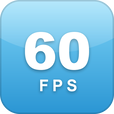

# Flappy 60FPS

Flappy Bird drawing at a smooth 60fps on iOS 6, installed as its own app next to the original. Same game speed.

## Features

- A 4-byte patch: the game logic already ran at 60 Hz, and now every frame is drawn.
- Game speed is unchanged.
- Installs as its own app, Flappy 60FPS, next to the original.
- Game Center won't recognize it.

## How to use

1. Open Flappy 60FPS from the home screen and play as usual.

## Requirements

- Jailbroken iOS 6 (tested on an iPhone 5 with iOS 6.1.2)
- UIKit Tools (Cydia installs them for you)

## Install

In Cydia, add `https://mbucc9000.github.io/slopkit/` and install **Flappy 60FPS**. Or download the `.deb` from [Releases](../../releases) and install it with `dpkg -i`.

## Building

`py -3 build_flappy_deb.py` turns the 60fps IPA into the `.deb` (Python 3).

## License

MIT.
